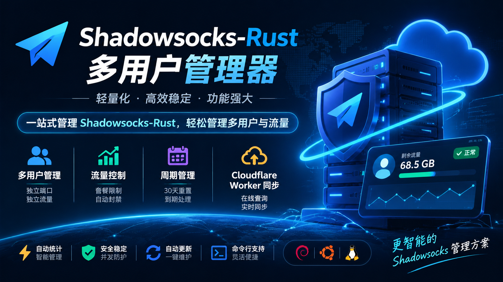

# Shadowsocks-Rust 多用户管理器

一个基于 **Shadowsocks-Rust** 的轻量级多用户管理脚本，提供用户管理、流量统计、套餐周期、自动限速封禁、到期管理以及 Cloudflare Worker 云端同步等功能。

通过交互式菜单即可完成日常管理，无需手动维护 Shadowsocks 配置文件。

## ✨ 功能特性

- **多用户管理**：支持创建、删除、查询多个 Shadowsocks 用户。
- **独立端口**：每个用户拥有独立端口、密码和连接配置。
- **流量限制**：支持为每个用户设置独立流量套餐。
- **自动流量统计**：通过 iptables 统计用户 TCP / UDP 流量。
- **自动超限封禁**：用户流量达到套餐上限后，自动阻断对应端口。
- **周期自动重置**：每个周期为 30 天，到达周期边界自动清零流量。
- **超限自动恢复**：进入下一个流量周期后，因流量超限被禁用的用户自动恢复。
- **账号到期管理**：支持按周期购买套餐，到期后自动永久禁用，需要续费才能恢复。
- **灵活续费**：支持增加套餐周期，续费从当前到期时间或当前时间开始计算。
- **流量重置**：支持单用户或全部用户重置本周期流量。
- **SS 链接导出**：自动生成 Shadowsocks 导入链接，支持批量导出。
- **Cloudflare Worker 同步**：将用户流量、剩余额度、到期时间和状态同步至 Worker。
- **在线流量查询**：用户通过专属查询链接查看自己的流量和账号状态。
- **自动定时检查**：通过 Cron 定时执行流量检查。
- **日志管理**：支持查看服务日志和管理器日志，日志保留约 7 天。
- **并发安全**：使用文件锁和原子写入，降低定时任务与人工操作同时修改数据造成的数据丢失风险。
- **自动更新**：支持获取并更新 Shadowsocks-Rust 最新版本。
- **卸载清理**：支持清理服务、定时任务、iptables 规则及相关配置。

## 🖥️ 系统支持

- Debian 系列 Linux 系统
- Ubuntu 系列 Linux 系统
- x86_64 / amd64
- ARM64 / aarch64
<p align="center">
  
</p>

## 🚀 安装使用

使用 root 用户执行：

```bash
bash <(curl -fsSL https://raw.githubusercontent.com/SunMoonWithYou/ss_manage/main/install.sh?$(date +%s))
```

首次运行会自动完成：

1. 检查并安装所需依赖。
2. 下载并安装最新版本 Shadowsocks-Rust。
3. 创建 systemd 服务。
4. 配置 Cron 定时任务。
5. 配置日志轮转。
6. 初始化用户数据及防火墙规则。
7. 进入交互式管理菜单。

## 📋 管理菜单

| 编号 | 功能 |
|---|---|
| 1 | 添加用户 |
| 2 | 删除用户 |
| 3 | 用户列表 |
| 4 | 用户详情 |
| 5 | 重置本周期流量 |
| 6 | 用户续费（增加周期） |
| 7 | 重置全部用户流量 |
| 8 | 导出全部 SS 导入链接 |
| 9 | 配置 Cloudflare Worker 同步 |
| 10 | 手动同步到 Worker |
| 11 | 删除 Worker 同步 |
| 12 | 查看服务状态 |
| 13 | 查看服务日志 |
| 14 | 查看管理器日志 |
| 15 | 更新 Shadowsocks-Rust |
| 16 | 手动流量检查 |
| 17 | 重建 iptables 规则 |
| 18 | 卸载 |

## 📊 套餐周期说明

每个用户拥有独立的流量套餐和使用周期。

- 一个周期固定为 30 天。
- 每个周期开始时，当前周期已用流量自动清零。
- 总累计流量独立记录，不受周期重置影响。
- 流量达到限制后，自动禁用用户。
- 下一个周期到来后，因流量超限禁用的用户自动恢复。
- 账号到期后永久禁用，不会因为流量重置而恢复。
- 续费从 `max(当前时间, 当前到期时间)` 开始增加周期。
- 流量限制填写 `0` 表示不限流量。

支持的流量单位：

`512M`、`10G`、`100G`、`1.5T`

## ☁️ Cloudflare Worker 同步

支持将用户信息同步到 Cloudflare Worker，实现在线流量查询。
Cloudflare Worker 后台代码
https://github.com/SunMoonWithYou/ss_monitoring_panel

同步数据包括：

- 用户名称
- 已使用流量
- 套餐流量
- 账号到期时间
- 当前流量周期结束时间
- 用户端口
- 用户状态
- 独立查询 Key

### 同步机制

- 默认最多每小时自动同步一次。
- 用户增删改后可立即触发同步。
- 支持手动同步。
- 支持停用 Worker 同步。
- 停用时可选择清理云端数据。
- 未配置 Worker 时，不影响 Shadowsocks 核心功能。

### Worker 配置

脚本支持通过 `worker.conf` 保存 Worker 配置，建议将 Token 保存在该文件中，不要直接提交到 GitHub。

## 📁 数据文件

| 文件 | 用途 |
|---|---|
| `/etc/shadowsocks-rust/config.json` | Shadowsocks 服务配置 |
| `/etc/shadowsocks-rust/users.json` | 用户信息、流量及套餐数据 |
| `/etc/shadowsocks-rust/manager.log` | 管理器运行日志 |
| `/etc/shadowsocks-rust/worker.conf` | Cloudflare Worker 配置 |
| `/usr/local/bin/ss-manager` | 管理脚本 |
| `/usr/local/bin/ssserver` | Shadowsocks-Rust 服务程序 |

## 🔧 命令行管理

安装后可以直接使用以下命令：

```bash
ss-manager              # 打开管理菜单
ss-manager list         # 查看用户列表
ss-manager add          # 添加用户
ss-manager status       # 查看服务状态
ss-manager logs         # 查看服务日志
ss-manager update       # 更新 Shadowsocks-Rust
ss-manager sync         # 手动同步 Worker
ss-manager uninstall    # 卸载
```

其他支持的命令：

```bash
ss-manager traffic-check
ss-manager unsync
ss-manager unsync -y
```

## ⚠️ 注意事项

1. 请使用 root 用户运行。
2. 服务器需要能够正常访问 GitHub Releases。
3. 流量统计依赖 iptables，请确保系统支持相关防火墙规则。
4. 请勿随意修改 `users.json`，避免影响用户数据。
5. 建议定期备份 `/etc/shadowsocks-rust/` 目录。
6. Cloudflare Worker 同步需要自行配置对应的 Worker 接口及 Token。
7. 卸载操作会删除用户数据、服务配置和相关管理文件，请提前备份。

## 📄 免责声明

本项目仅供学习、研究及个人技术交流使用。

使用者应遵守所在国家和地区的法律法规。因使用本项目产生的任何问题，由使用者自行承担责任。

---

**Shadowsocks-Rust Multi-User Manager**

轻量化管理 · 独立流量统计 · 自动套餐管理 · Cloudflare 云端同步
